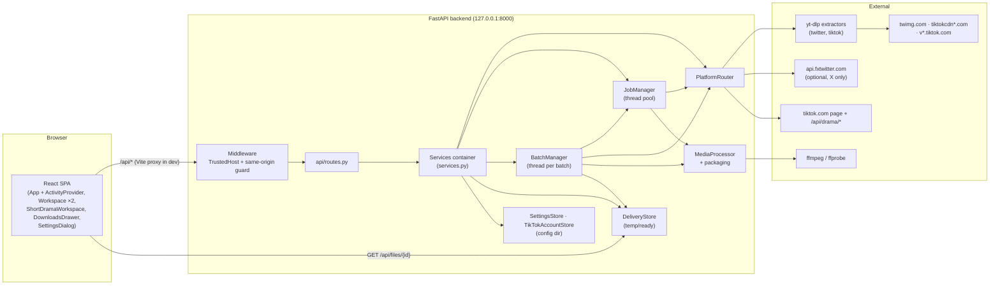
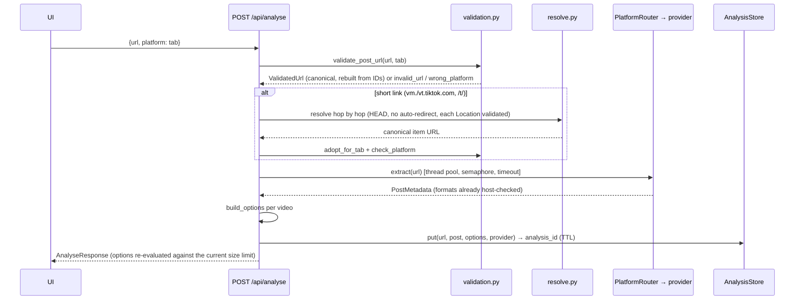
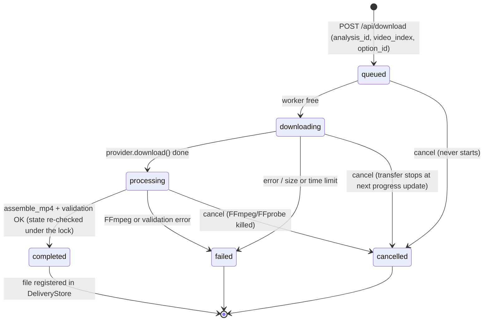
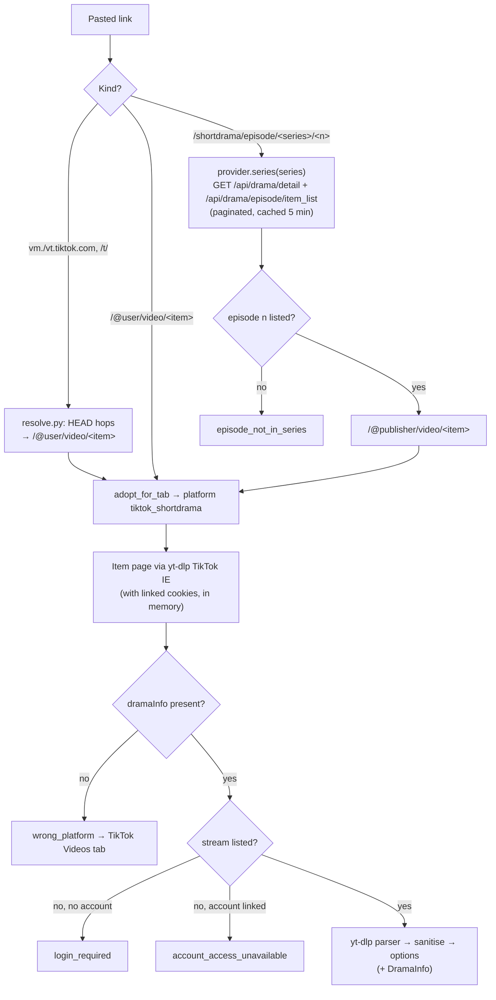
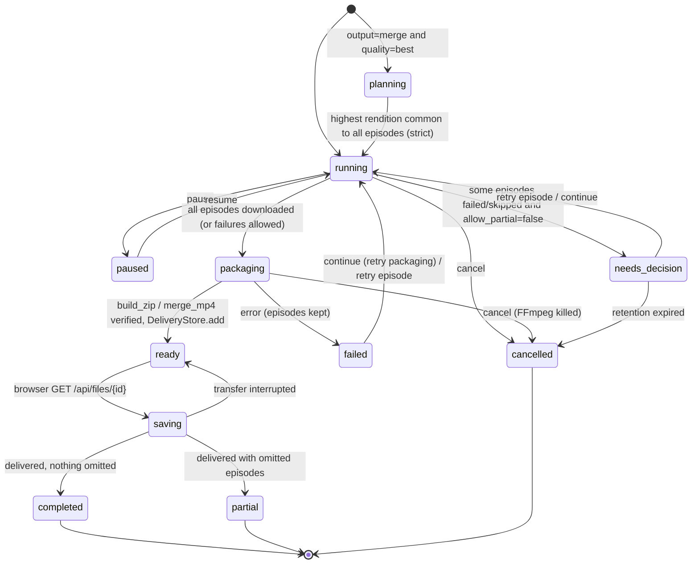
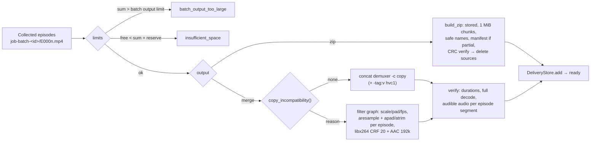
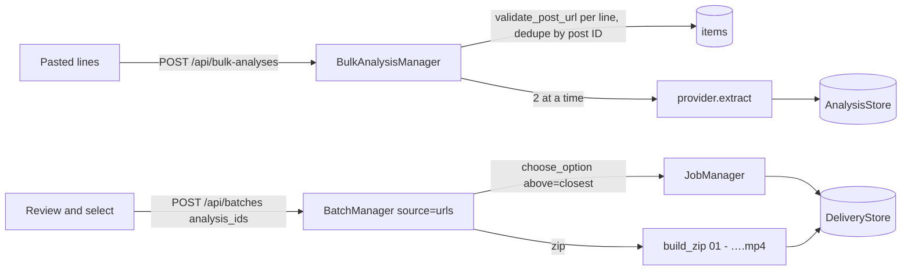

# Architecture

MediaLab is two small programs on one machine: a **React** single-page app and a **FastAPI** backend that drives **yt-dlp** (extraction), **FFmpeg/FFprobe** (processing and verification) and, for TikTok Short Drama, a handful of TikTok web endpoints. There is no database, no account system and no permanent media storage: finished files are handed to the browser and deleted.

This document describes the code as of v1.9.0. Module paths are relative to `backend/app/` and `frontend/src/`.

## 1. High-level system



In development the Vite server (`127.0.0.1:5173`) serves the UI and proxies `/api` to the backend. `make start` builds the UI and lets FastAPI serve it from `frontend/dist` on port 8000.

## 2. Backend

### 2.1 Composition (`main.py`, `services.py`)

`create_app(settings, provider, processor)` builds everything; tests pass fakes for `provider` and `processor`.

- **Settings** (`config.Settings`) come from the environment/`.env` and are immutable. GUI preferences live separately in `user_settings.SettingsStore` (`settings.json`).
- **Provider graph** (`build_default_provider`):

  ```python
  PlatformRouter({
      "x": ProviderChain(YtDlpProvider(settings, "x"), FxTwitterProvider(settings),
                         enabled=lambda: store.get().fxtwitter_fallback),
      "tiktok": YtDlpProvider(settings, "tiktok"),            # drama_probe set for wrong-tab hints
      "tiktok_shortdrama": TikTokShortDramaProvider(settings, account_store),
  })
  ```
- **`Services`** holds the router, `MediaProcessor`, `AnalysisStore`, `DeliveryStore`, `JobManager`, `BatchManager`, the TikTok account store, a thread pool for analyses and an `asyncio.Semaphore` that bounds concurrent analyses.
- **Lifespan**: on start, folders are prepared (`prepare_directories`), all leftover `job-*` folders and the delivery area are wiped (nothing from a previous run can still be in use), and a periodic cleanup task runs every `CLEANUP_INTERVAL` seconds (`run_cleanup`). On shutdown, batches are signalled to stop and executors shut down.
- **Middleware**: `TrustedHostMiddleware` (loopback names only) and `same_origin_guard`. The guard refuses `/api` requests that a browser marks cross-site or that carry a foreign `Origin` (all methods), plus `Origin: null` on state-changing methods.
- **Error handlers** turn every `AppError` into `{"error": {...}}` with the code's HTTP status and log method, path, code and the exception's cause chain. Validation errors become `validation_error` (422); anything unexpected becomes `internal_error` (500) without details.

### 2.2 Async/sync boundaries

FastAPI's event loop never runs extraction, FFmpeg or file I/O:

| Work | Where it runs |
|---|---|
| `POST /api/analyse`, `GET /api/shortdrama/series/{id}` | `analysis_executor` threads, behind the analysis semaphore, with `asyncio.wait_for` + `shield` (the slot is released when the thread really ends) |
| `POST /api/shortdrama/batches` | `analysis_executor` (it looks up the series) |
| Downloads and per-file processing | `JobManager` thread pool (`MAX_CONCURRENT_DOWNLOADS`) |
| Batch scheduling, merge planning, ZIP/merge packaging | one daemon thread per batch |
| File delivery | `DeliveryResponse` reads 1 MiB chunks in a worker thread |
| Other sync routes (`download`, `jobs`, `settings`, account) | FastAPI's threadpool (plain `def` routes) |

Shared state is protected by locks (`JobManager._lock`, `BatchManager._lock`, `DeliveryStore._lock`, the settings and account stores). Workers copy what they need under the lock and do network/FFmpeg work outside it.

### 2.3 Module map

| Module | Responsibility |
|---|---|
| `validation.py` | URL allowlists, parsing and canonicalisation (X, TikTok, Short Drama); tab checks (`check_platform`, `adopt_for_tab`); media-host predicates |
| `resolve.py` | TikTok short links: HEAD requests, one validated hop at a time |
| `net.py` | https-only `urllib` client that validates every redirect hop (FxTwitter, short links) |
| `providers/base.py` | `VideoProvider` interface: `extract`, `download`, `provider_for` |
| `providers/router.py` | `PlatformRouter`: per-platform provider; stamps the provider name on results |
| `providers/chain.py` | `ProviderChain`: primary, then fallback on `no_video`/`not_found` while enabled |
| `providers/ytdlp_provider.py` | yt-dlp provider per `PlatformSpec`: sanitising, exact sizes, downloads with retries, error mapping |
| `providers/ytdlp_normalise.py` | yt-dlp info dict → domain models |
| `providers/fxtwitter_provider.py` | Optional FxTwitter metadata + direct X CDN download |
| `providers/tiktok_shortdrama.py` | Short Drama: item pages, series endpoints, direct-link resolution, account cookies |
| `models.py` | Domain models (`PostMetadata`, `VideoEntry`, `MediaFormat`, `ResolutionOption`, `DramaInfo`, `SeriesInfo`) |
| `selection.py` | Resolution options, Best Available, audio-conversion flags, size limits, batch quality choice |
| `jobs.py` | `JobManager`: queue, state machine, progress, limits, cancellation, soundtrack fallback |
| `media.py` | FFprobe parsing; `assemble_mp4` (video copy, audio copy or AAC); output validation |
| `packaging.py` | ZIP building, MP4 merging (copy or normalise), cancellable FFmpeg, merge verification |
| `batches.py` | `BatchManager`: one queue for Short Drama series (`files` / `zip` / `merge`) and X/TikTok link batches (`files` / `zip`): concurrency, item and batch cancel, retry, partial-failure decisions, packaging |
| `bulk.py` | `BulkAnalysisManager`: validates pasted links, removes duplicates, analyses each once (two at a time), cancellable; `analyse_validated` shared with link batches |
| `storage.py` | Filenames, `AnalysisStore`, `DeliveryStore`, cleanup, disk-space checks |
| `tiktok_account.py` | Optional TikTok cookies: parse, filter, store 0600, status, removal |
| `user_settings.py` | GUI settings with strict bounds, atomic persistence |
| `errors.py` | `ErrorCode`, HTTP statuses, retryability, default actions, `AppError` |
| `schemas.py` | Request/response models and converters (`job_to_response`, `batch_to_response`) |
| `api/routes.py`, `api/delivery.py` | HTTP endpoints; streaming file delivery |

## 3. Provider abstraction and platform routing

Everything outside `providers/` depends only on `VideoProvider` and the domain models:

```python
class VideoProvider(ABC):
    name: str
    def provider_for(self, name, platform) -> VideoProvider: ...   # who must download an analysis
    def extract(self, url: ValidatedUrl) -> PostMetadata: ...
    def download(self, url, video_index, format_ids, dest_dir, on_progress) -> dict[str, Path]: ...
```

- The **router** picks the provider by `ValidatedUrl.platform` (`x`, `tiktok`, `tiktok_shortdrama`). Platforms never share providers.
- The **chain** (X only) records which member answered. `JobManager` asks `provider_for(analysis.provider, platform)`, so the provider that analysed a post also downloads it.
- **yt-dlp providers** are parameterised by `PlatformSpec`: extractor name (`allowed_extractors`), media-host predicate, format filters and error wording. The generic extractor is never loaded.
- **`TikTokShortDramaProvider`** subclasses `YtDlpProvider`, overriding `_raw_info` (read the item page itself to see `dramaInfo`), `_finish` (attach `DramaInfo`), `_ydl` (load the linked cookies in memory) and `_keep_separate_audio`.

See [PROVIDERS.md](PROVIDERS.md) for each provider.

## 4. Metadata normalisation

Providers return `PostMetadata` → `VideoEntry` → `MediaFormat`. Normalisation never guesses: unknown values are `null`, and `has_video`/`has_audio` are `None` when the source doesn't say. `selection.build_options` turns formats into **one option per real resolution** (labelled by the short side), pairing video-only streams with the best audio-only stream when one is offered, and records:

- `audio_converted` (audio will become AAC),
- `fallback_audio_format_id` (separate audio to add if a "with audio" stream turns out to have none),
- `downloadable` / `too_large`, and a human `note`.

**Best Available** is the highest downloadable option *with audio* whenever the source has audio.

## 5. Analysis lifecycle



## 6. Download lifecycle



- `POST /api/download` accepts only IDs. The server looks up the canonical URL and format IDs it stored, checks free space (≈2× the file + reserve) and **freezes the size limit into the job**.
- **downloading**: the provider writes into `temp/job-<id>/attempt-N/`. The progress hook aggregates bytes and enforces the size limit, timeout and cancellation. A CDN HTTP 403 is retried with fresh URLs (TikTok: the mirror); an interrupted transfer backs off 2 s/4 s; at most 3 attempts. When TikTok serves a different encode of the same rendition, the equivalent format ID is used.
- **processing**: if a "with audio" stream has no audio and a trusted separate track exists, it is downloaded (soundtrack fallback). `MediaProcessor.assemble_mp4` then copies video, copies or converts audio, and validates the output (see [MEDIA_PIPELINE.md](MEDIA_PIPELINE.md)).
- **completed**: the MP4 is renamed into `temp/ready/<random>.mp4` and registered for delivery. The job folder is always removed in `finally`.
- **cancelled** (v1.9): `JobManager.cancel` sets the state, the error (`download_cancelled` or the batch's reason) and the job's cancel event under the manager lock. The worker runs inside `MediaProcessor.cancellable(event)`, so every FFmpeg/FFprobe call it makes polls the event every 0.2 s and is killed when it is set; the download progress hook raises on its next call. The completion step takes the same lock and checks the state first, so the race "cancel while the last FFmpeg step finishes" always ends `cancelled`, with no delivery registered. The job folder stays listed as active until the worker has really exited.
- **Duplicates:** `submit` refuses a job whose canonical URL, video index and format IDs match an active job (`already_downloading`, with the running `job_id`).

## 7. Short Drama episode resolution



The item page's status codes are mapped explicitly: `203008` → `not_found` ("internal episode record"), `10216`/`10222` → `unavailable`, `10204` → `not_found`. An expired linked session (by cookie expiry) is `auth_expired`.

## 8. Batch lifecycle (ZIP / merged MP4)



- Each episode goes through the **normal job pipeline**. In `zip`/`merge` mode the finished file is moved (`DeliveryStore.take`) into `temp/job-batch-<id>/E0001.mp4`, so it's never offered to the browser on its own. In `files` mode the browser saves each episode and at most `concurrency + 1` finished episodes wait in temporary storage.
- The batch worker ticks every 0.5 s: refresh job and delivery states, decide the next transition, start at most one new episode per tick (bounded by `concurrency`, ≤ 2).
- A `zip`/`merge` batch that ends up with a single episode delivers it as a plain MP4 (no archive, no processing).



### 8.1 Link batches (v1.9)



- A link batch is a `Batch` with `source="urls"` and `platform`; items are `BatchEpisode`s numbered in input order that carry their `analysis_id`. Everything else (queue tick, concurrency, `MAX_UNSAVED` back-pressure for separate files, the `needs_decision` failure policy, packaging, delivery, pruning) is the Short Drama code path.
- Starting an item reads the stored analysis (re-analysing only if it expired), picks the option for the batch's quality preference and submits an ordinary job, so every per-download safeguard applies.
- Cancelling: `cancel_item` cancels one item (its job immediately); `cancel` on a link batch keeps finished items (`stopped`, see [API.md](API.md#batch-control)); Short Drama keeps its v1.4 discard semantics.
- Limits: `MAX_ACTIVE_BATCHES` (2) counts both kinds; at most `max_bulk_urls` items; batch concurrency `min(requested, 4, max_concurrent_downloads)`.

## 9. Browser delivery and temporary storage

```mermaid
sequenceDiagram
    participant UI as Browser
    participant API as GET /api/files/{id}
    participant DS as DeliveryStore
    participant FS as temp/ready/
    UI->>API: GET (same-origin link or fetch for folder saving)
    API->>DS: begin(id)
    alt unknown / delivered / expired
        DS-->>UI: 404 file_not_found
    else already streaming
        DS-->>UI: 409 delivery_in_progress
    else ready
        DS->>DS: state = delivering
        API->>FS: stream 1 MiB chunks (worker thread)
        API-->>UI: 200 video/mp4 or application/zip, attachment, no-store
        API->>DS: finish(completed)
        alt every byte sent
            DS->>FS: delete file → delivered
        else disconnect
            DS->>DS: back to ready (retry until expiry)
        end
    end
    Note over DS,FS: periodic prune: unsaved files expire after DELIVERY_RETENTION_MINUTES;<br/>never a file in "delivering"; orphans removed
```

Temporary layout (`MEDIALAB_TEMP_DIR`, default `<system temp>/medialab`):

| Path | Contents | Removed |
|---|---|---|
| `job-<id>/attempt-N/` | partial downloads and the processed MP4 | when the job ends (any outcome); all at startup |
| `job-batch-<id>/` | collected episodes, ZIP/merge work files | after delivery, cancellation, expiry, or at startup |
| `ready/<id>.mp4` / `.zip` | finished files waiting for the browser | after a complete transfer or after the retention period |

MediaLab's own subfolders are created owner-only (`0700`). Files are only ever addressed by random 128-bit IDs.

## 10. Settings persistence

`SettingsStore` keeps `UserSettings` (`fxtwitter_fallback`, `max_file_size_mb`, `batch_output_max_mb`) in memory and in `settings.json` (atomic write, `0600`). Environment values only seed the first run. `PATCH /api/settings` accepts only those three keys with strict types and bounds. A size-limit change applies to new jobs; a running job keeps the limit frozen into its plan.

## 11. Authentication boundaries

The only credential MediaLab handles is the optional TikTok cookie file (see [SECURITY.md](SECURITY.md#tiktok-account)). It is:

- parsed and filtered to `tiktok.com` cookies on upload, stored `0600` at a fixed path, never returned by the API;
- loaded **in memory** into the yt-dlp cookie jar of the **Short Drama provider only** (`TikTokShortDramaProvider._ydl`), never written back;
- never used by the X chain, FxTwitter, the TikTok Videos tab or its wrong-tab probe.

## 12. Error-handling architecture

`AppError(code, message, status_code?, action?, retryable?, details?)` is the only error type that crosses module boundaries. `errors.py` holds each code's HTTP status, default action and retryability.

- Providers map extractor errors (`map_ytdlp_error`) to specific codes, keeping the extractor's reason for unrecognised failures (`extraction_failed`).
- Jobs and batches store the `AppError`; the API serialises it in the same shape as request errors.
- Retries (`retry.with_retries`, provider download loop) are bounded and only for transient codes.
- The app logs the cause chain server-side; clients get only safe text.

## 13. Frontend

Design rules, tokens and components: [FRONTEND_DESIGN_SYSTEM.md](FRONTEND_DESIGN_SYSTEM.md).

```
main.tsx
└─ App ─ ActivityProvider (lib/activity.tsx: one registry + one 800 ms polling loop for all jobs and batches)
   └─ Shell: header [Downloads (badge)] [⚙]  ·  platform Tabs (X | TikTok Videos | TikTok Short Drama)
      ├─ PlatformWorkspace (x)       ┐ panels stay mounted (hidden), so each keeps its state
      ├─ PlatformWorkspace (tiktok)  ┘ segmented Single | Bulk
      │   ├─ Single: Workspace       UrlForm [Analyse] [New Download] → VideoDetails → ResolutionPicker → DownloadPanel (Cancel)
      │   └─ Bulk: BulkWorkspace     links textarea → review list → options → BatchProgress (shared with Short Drama)
      ├─ ShortDramaWorkspace         segmented Episode | Series
      │   ├─ Episode: Workspace flow + "Open series"
      │   └─ SeriesView: EpisodeList (Shift-click ranges) · BatchProgress · BatchActionBar (sticky; Options popover)
      ├─ DownloadsDrawer             Dialog placement="right": every job and batch, from any tab
      └─ SettingsDialog              Dialog: General · Download limits · TikTok account
```

| File | Role |
|---|---|
| `App.tsx` | `ActivityProvider`, header, platform tabs, cross-tab switching, drawer and settings state (opening Settings at a section) |
| `lib/activity.tsx` | Activity registry: `startJob` (follows the running job on `already_downloading`), `retryJob`, `cancelJob`, `saveJob`, `startBatch`, `startUrlBatch`, `batchControl`, `retryEpisode`, `cancelItem`, `saveBatchResult`, `saveEpisodeAgain`, `dismiss`, `clearFinished`; counts for the header; a polite live region announcing stage changes; auto-saving of separate-files batches; marks entries `lost` on `job_not_found`/`batch_not_found` |
| `components/Workspace.tsx` | One video's flow (analyse → choose → download → save); reads its job from the registry, so leaving the tab loses nothing. **New Download** bumps a generation counter and aborts the request, so late responses and just-started jobs never repopulate the reset view |
| `components/bulk/PlatformWorkspace.tsx`, `BulkWorkspace.tsx` | Single/Bulk switch for X and TikTok; Bulk: instant line preview (`lib/bulk.ts`), server bulk analysis polled every 800 ms, review and selection, options, link batch via the registry |
| `components/shortdrama/ShortDramaWorkspace.tsx` | Episode / Series views; carries the analysed episode into Series |
| `components/shortdrama/SeriesView.tsx` | Lazy series load, preselects the current episode, selection (`lib/selection.ts`), output choice remembered in `localStorage` (`medialab.batchOutput`), batch creation; locks selection while the series' batch runs |
| `components/shortdrama/EpisodeList.tsx`, `BatchActionBar.tsx`, `BatchProgress.tsx` | Episode rows; sticky action bar with Options popover (quality, strict, parallel, partial, folder); summary-first batch progress |
| `components/downloads/DownloadsDrawer.tsx` | Needs attention · In progress · Finished; Save, Retry, Cancel, Continue, Dismiss, Clear finished |
| `components/settings/SettingsDialog.tsx` | Sectioned settings (temporary storage info; size limits and FxTwitter; TikTok account link/replace/remove) |
| `components/brand/Logo.tsx` | `LogoMark` (emblem SVG) and `Wordmark`; static logo/icon files in `public/brand/`, favicon in `public/` |
| `components/ui/` | Design-system kit: `Button`, `Card`, `Badge`, `Alert`, `Disclosure`, `ProgressBar`, `Tabs`, `Dialog`, `Popover`, `useModal`, icons |
| `components/*` | `UrlForm`, `VideoDetails`, `ResolutionPicker`, `FormatTable`, `DownloadPanel`, `ErrorAlert` |
| `lib/api.ts` | Typed fetch wrapper (incl. `cancelJob`); `{error}` bodies → `ApiError`; proxy 502/503/504 → "backend unreachable" |
| `lib/theme.ts` | Dark-by-default theme: saved choice in `localStorage`, `data-theme` on `<html>`, `useTheme` for the header toggle (mirrors the pre-render script in `index.html`) |
| `lib/save.ts`, `lib/selection.ts` | Saving (`<a download>` or folder writes, never overwrite); pure selection helpers (range, from episode, keep accessible, describe) |
| `lib/platform.ts`, `lib/format.ts`, `lib/types.ts` | Tab metadata and URL hints, formatting, API types mirroring `schemas.py` |

State: the activity registry is the only shared store (jobs and batches, in memory for the page's lifetime). Analyses and form state stay local to each workspace; settings and the TikTok account status live in `App`. Closing the page forgets the registry; the backend keeps its own state independently.

## 14. Known architectural limitations

- **In-memory state.** Analyses, jobs and batches don't survive a backend restart; temporary files are wiped at startup. See [DESIGN_DECISIONS.md](DESIGN_DECISIONS.md#d15-in-memory-job-and-batch-state) for the trade-off and recommendation.
- **yt-dlp internals.** The Short Drama provider calls two private yt-dlp TikTok methods (`_extract_web_data_and_status`, `_parse_aweme_video_web`); a yt-dlp update can break it (it fails with `extraction_failed` and an update hint).
- **Single process.** Locks and thread pools assume one backend process.
