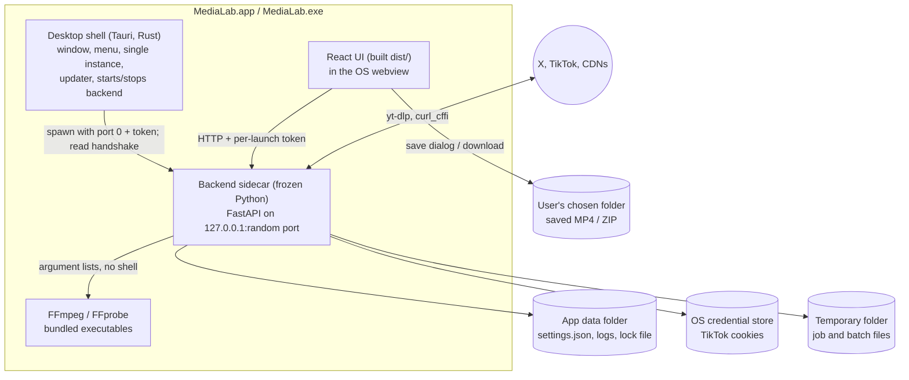
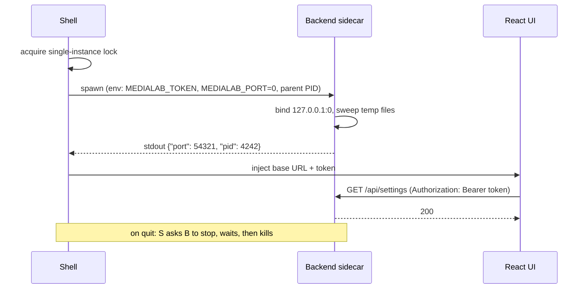

# Desktop architecture proposal

*Status: **proposed, not approved**. Written 2026-11-14 for community feedback; nothing is implemented. It assumes the recommended packaging (Tauri 2 shell with a PyInstaller onedir backend; see [DESKTOP_PACKAGING_OPTIONS.md](DESKTOP_PACKAGING_OPTIONS.md)). Most of it applies equally to a pywebview shell.*

## 1. Overview

| Part | Responsibility |
|---|---|
| **Shell** | One window; prevents a second instance; starts the backend, waits for its handshake, passes the address and token to the UI, stops it on quit; checks for signed updates; shows a friendly error if the backend can't start |
| **React UI** | Unchanged components; `lib/api.ts` gets its base URL and token from the shell instead of assuming same-origin |
| **Backend** | The current FastAPI app plus: dynamic port, token check, parent-process watchdog, file logging with redaction, platform paths |
| **FFmpeg** | Bundled next to the backend; found through an explicit path setting (`MEDIALAB_FFMPEG`), never via `PATH` |

## 2. Data locations

| Data | macOS | Windows | Notes |
|---|---|---|---|
| Settings | `~/Library/Application Support/MediaLab/settings.json` | `%APPDATA%\MediaLab\settings.json` | Same file format as today |
| TikTok cookies | **Keychain** item | **Credential Manager** (DPAPI-protected) | Replaces today's 0600 file; migrate an existing file once, then delete it |
| Logs | `~/Library/Logs/MediaLab/` | `%LOCALAPPDATA%\MediaLab\Logs\` | Rotating, size-capped; query strings and cookie headers redacted (CR-11) |
| Temporary files | per-user temp folder `/MediaLab` | `%LOCALAPPDATA%\Temp\MediaLab` | Swept at start as today |
| Lock file | app data folder | app data folder | Holds PID and port; see section 5 |

Storing cookies in the OS credential store needs a small abstraction (`keyring` or native calls through the shell); it keeps cookies out of backups and away from other local users. **Open question:** is the extra dependency worth it versus a permission-restricted file plus DPAPI on Windows?

## 3. Cross-platform files and paths

- Per-user locations only (section 2); never write next to the application bundle (it's read-only once signed).
- Windows: avoid reserved names (`CON`, `PRN`, `AUX`, `NUL`, `COM1`…`LPT9`), trailing dots and spaces in file and ZIP entry names; keep full paths under the classic 260-character limit or enable long-path support; replace POSIX permission calls (`os.fchmod`, `0o700`) with per-user locations and Windows ACLs or DPAPI (CR-04).
- macOS: the sandbox isn't used (Developer ID distribution), but files go only to folders the user picked in a save dialog.
- Both: case-insensitive file systems are common, so de-duplicate output names case-insensitively.

## 3a. Saving files

Today the browser saves files (`<a download>` or the File System Access API). In a webview:

- **WKWebView and WebView2 handle downloads differently** and neither offers the File System Access API in the same way as Chrome.
- Proposal: the UI asks the shell for a destination with a **native save/folder dialog**; the shell passes the chosen path to the backend, which copies the finished file from temporary storage. The same "delivered exactly once, then deleted" rules apply. This also removes CR-01 (stream-close race) for the desktop app.
- The backend only writes into folders the user picked in a dialog during this session, never arbitrary paths from the UI.

## 4. Local communication between the UI and the backend

### Should packaged builds keep HTTP on localhost?

Keeping HTTP preserves the whole tested API and frontend, which matters for a one-person project. The risks of today's design are the open port and the lack of authentication (CR-02). They can be reduced without a rewrite:

| Measure | What it does |
|---|---|
| **Loopback binding** | Only `127.0.0.1` (and refuse `0.0.0.0`), as today |
| **Dynamic port** | Backend binds port `0`, so the OS picks a free port: no clash with other apps or a second copy |
| **Per-launch token** | The shell generates 32 random bytes per launch and passes them to the backend through an environment variable or stdin (never the command line, which other users can see); every request must carry it in an `Authorization: Bearer` header; file downloads use short-lived signed links or the native save flow |
| **Host and Origin checks** | Keep them; allow only the shell's origin (`tauri://localhost` or `http://tauri.localhost`, depending on platform) |
| **Handshake** | The backend prints one JSON line (`{"port": 54321, "pid": 4242}`) to stdout when ready; the shell waits for it with a timeout |

### Alternatives

| Mechanism | Pros | Cons |
|---|---|---|
| HTTP on loopback with token (proposed) | Reuses everything; testable with curl; streaming downloads work | A TCP port exists; the token is the only barrier against other local users |
| Unix domain socket / Windows named pipe | No TCP port; OS file permissions restrict access to the user | Webviews can't fetch from a socket directly: the shell must proxy every request (Tauri commands or a custom protocol handler), including streams; more Rust code |
| Tauri IPC commands only | Strongest isolation; no port | Re-implementing the API as commands; large change to `lib/api.ts` and tests |

**Recommendation:** loopback HTTP with a dynamic port and per-launch token in the first desktop release; revisit a socket/pipe behind a Tauri custom protocol later if the token approach proves insufficient. The token and dynamic port could also be offered as an opt-in for the source version.

## 5. Lifecycle

- **Single instance:** the shell uses a single-instance mechanism (a Tauri plugin exists) and a lock file holding the backend PID and port; opening MediaLab again focuses the existing window.
- **Startup:** shell window shows "Starting MediaLab…" until the handshake arrives (timeout around 20 s, then an error with a "Show log" button).
- **Shutdown:** on quit the shell calls `POST /api/shutdown` (token-protected): the backend cancels running jobs through the v1.9 cancellation path (FFmpeg killed, temporary files removed) and exits; after a grace period the shell kills the process tree. If downloads are running, the shell asks the user first.
- **Orphan protection:** the backend watches its parent (stdin closed, or the parent PID gone) and exits by itself, so a crashed shell never leaves a backend running.
- **Crash recovery:** if the backend exits unexpectedly, the shell offers to restart it. In-memory jobs are lost, as today; the UI already shows them as "no longer available". Temporary files are swept at the next start.

## 6. Updates

- **Application updates** through Tauri's signed updater (signature checks can't be turned off). Releases are built and signed in CI; the update manifest lives with the GitHub Release.
- **yt-dlp updates** ship inside application updates. A separate yt-dlp channel would mean downloading and running code outside the signed app bundle, which conflicts with notarisation and the update signatures, so it isn't proposed.
- Because platforms change frequently, plan a lightweight release process (see [OPEN_SOURCE_MAINTAINER_GUIDE.md](OPEN_SOURCE_MAINTAINER_GUIDE.md#release-process)).

## 7. Error logging and support

- Rotating log files (for example 5 × 2 MB) with redaction of URL query strings, cookie and authorization headers.
- A "Copy diagnostic info" action that collects versions (MediaLab, yt-dlp, FFmpeg, OS) and recent error codes, never cookies or URLs with tokens.
- No telemetry.

## 8. Phased migration

| Phase | Work | Done when |
|---|---|---|
| 0. Groundwork in the source app | Fix CR-04 (Windows paths, `os.fchmod`, reserved names), CR-01, CR-11; FFmpeg path setting; dynamic port + token as an opt-in; `/api/shutdown`; parent watchdog | Tests pass on macOS and Windows CI |
| 1. Frozen backend | PyInstaller onedir build of the backend + FFmpeg on macOS arm64 and Windows x64; licence notices generated | Runs on clean machines; size and startup measured |
| 2. Shell prototype | Tauri shell with sidecar, handshake, single instance, shutdown | Unsigned internal builds work end to end |
| 3. Native saving and credentials | Save dialogs, Keychain/Credential Manager for cookies, log files | Feature parity with the browser version |
| 4. Signing and updates | Apple Developer ID + notarisation; Windows Artifact Signing; signed updater; CI release workflow | A signed release candidate installs without warnings on macOS |
| 5. Public beta | Release notes, known issues, feedback through Discussions | Testers on both platforms |

Each phase is useful on its own and can stop if the community or the maintainer decides the cost is too high.

## 9. Open questions

1. Keychain/Credential Manager versus a protected file for cookies.
2. LGPL FFmpeg with platform encoders, or GPL FFmpeg as a separate executable.
3. Universal macOS build or Apple silicon only.
4. Whether to also ship Linux (AppImage/Flatpak) based on demand.
5. Budget for the Apple Developer Program and a Windows signing subscription.
